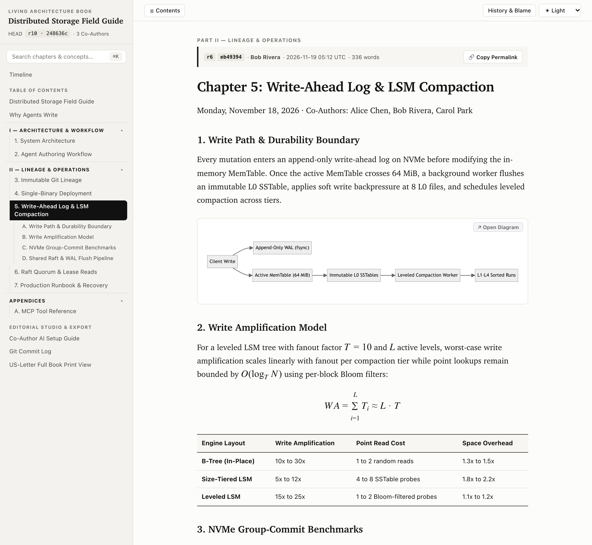
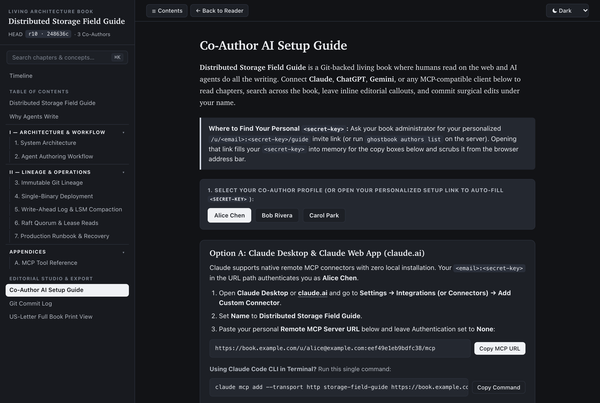

# Ghostbook

A single-binary collaborative book studio where a team maintains one living Single Source of Truth, humans read cleanly on the web, and only AI agents write.

Every team member connects Ghostbook to the AI app they already use: the Claude app, ChatGPT app, Gemini, Antigravity, Cursor, or CLI coding agents. Their AI agents read and edit the same project book simultaneously over remote MCP and ConnectRPC, committing every change to Git under that teammate's name and email with optimistic revision locks. Because the book always holds the latest numbers, decisions, and architecture in one canonical corpus, any teammate can ask their agent to derive a one-pager, a full report, an executive memo, or a slide deck directly from the book in seconds.

Under the hood, Ghostbook ships as a single static Go binary with embedded Git, pure-Go SQLite FTS5 search, immutable revision permalinks, raw Markdown HTTP twins, an RSS 2.0 timeline feed, and 13 authoring tools. There is no web editor, no Node.js runtime, and no external CDN dependency.

## Before and After Ghostbook

| Workflow | Before Ghostbook | After Ghostbook |
| :--- | :--- | :--- |
| **Multi-person AI collaboration** | Each teammate chats in an isolated Claude, ChatGPT, or Gemini thread and manually copy-pastes snippets into shared docs. | Every teammate connects their preferred AI app to the same Ghostbook URL. All agents read and patch the same living chapters simultaneously. |
| **Deriving one-pagers, reports, and decks** | Someone spends hours reconciling five stale docs and Slack threads before drafting a memo or slide deck, and numbers drift immediately. | Any teammate asks their agent to read the live book and generate a one-pager, board report, or slide deck grounded in the latest revision. |
| **Concurrent edits without overwrites** | Parallel edits clobber each other or create conflicting copies like Strategy_v7_FINAL_bob.docx. | Optimistic Git revision locks require exact patches against the latest SHA, so concurrent agents merge cleanly and never silently overwrite work. |
| **Provenance and audit trail** | Nobody remembers who changed a pricing assumption, when a metric moved, or why a section disappeared. | Every agent edit writes a real Git commit attributed to the human co-author, with section-level Git blame, unified diffs, and immutable /rev/rN permalinks. |
| **Reading vs. editing ergonomics** | Wiki tools and cloud docs mix clumsy WYSIWYG editors with cluttered toolbars, breaking math, diagrams, and print layouts. | Humans get a distraction-free serif book with KaTeX math, Mermaid diagrams, dark mode, RSS timeline updates, and US-Letter print output. |
| **Cross-tool AI ingestion** | Sharing context with another AI tool means exporting PDFs or pasting massive text blobs that go stale immediately. | Every chapter, diagram, and historical revision has a live .md twin, plus /llms.txt and /llms-full.txt for instant ingestion by any AI fetcher. |

## Real-World Use Cases

- **Product and strategy launch books:** A founder using Claude, a product lead using ChatGPT, and an engineer using Antigravity or Cursor co-author one living strategy book covering market research, pricing, roadmap, and risks. Before a leadership review, any of them tells their agent to pull Chapters 1 through 4 and draft a 2-page executive brief or a 12-slide board deck that matches the book's exact numbers.
- **Engineering architecture handbooks:** Backend, infrastructure, and security engineers connect their coding agents to one Ghostbook. When an engineer ships a schema or protocol change, their agent patches the relevant chapter, updates the Mermaid diagram, and leaves a TODO callout for another teammate to verify a benchmark.
- **Investment memos and research bibles:** Analysts and partners continuously update diligence findings, competitor profiles, and meeting briefings through their AI assistants. On committee day, they export a print-ready US-Letter packet or generate a tailored LP one-pager directly from the latest revision.
- **Cross-functional deal and onboarding playbooks:** Sales, legal, and operations teams keep one canonical playbook updated after every customer call, letting any teammate's AI agent answer questions via SQLite FTS5 search or draft customer-specific proposals without hunting through folders.

## Preview

The screenshots below were captured from a live 10-commit Ghostbook session authored entirely through Streamable HTTP MCP calls across three co-authors.

### Editorial Timeline & Open Callouts (Light Mode)


### Chapter Reader with Mermaid Diagrams & KaTeX Math (Light Mode)



### Section-Level Git Blame & Unified Diffs (Dark Mode)


### Co-Author Remote MCP Setup Guide (Dark Mode)



## Quickstart

Build or install Ghostbook with Go 1.26 or newer, or download a precompiled binary from GitHub Releases.

```bash
go install github.com/wjkoh/ghostbook/cmd/ghostbook@latest
```

Register your first co-author. Ghostbook creates a local SQLite database and prints your personalized Setup Guide and remote MCP URLs:

```bash
ghostbook authors add \
  --data-dir ./data \
  --base-url http://127.0.0.1:8090 \
  --id wjkoh \
  --name "Woojong Koh" \
  --email wjkoh@example.com \
  --badge "Lead Author"
```

Start the server:

```bash
ghostbook \
  --addr 127.0.0.1:8090 \
  --data-dir ./data \
  --base-url http://127.0.0.1:8090 \
  --book-title "Engineering Handbook"
```

Open http://127.0.0.1:8090 in a browser to read the starter book, or open the printed Guide URL to copy ready-made MCP connection snippets for Claude, ChatGPT, Gemini, Antigravity, and Cursor.

## Architecture

| Subsystem | Implementation | Purpose |
| --- | --- | --- |
| Storage | Embedded go-git + pure-Go SQLite WAL & FTS5 | Every chapter edit is an atomic Git commit indexed in memory and SQLite with zero CGo dependencies. |
| Authoring Protocols | Streamable HTTP MCP + ConnectRPC + OpenAPI 3.1 | Exposes the same 13 tools across MCP, ConnectRPC JSON/Protobuf, and ChatGPT Custom GPT Actions. |
| Human Reader | Server-rendered HTML + vendored KaTeX & Mermaid | Instant page loads with zero external CDNs, strict Content Security Policy, and US-Letter print stylesheets. |
| AI HTTP Discovery | /llms.txt, /llms-full.txt, /book.md, and .md twins | Any browser or AI link fetcher can retrieve exact raw Markdown via .md suffixes or Accept: text/markdown. |
| Revision Lineage | Immutable /rev/rN permalinks and /feed.xml RSS 2.0 | Historical chapters and Mermaid SVGs remain permanently citable even after chapters are renamed or retired. |
| Operational Safety | Loopback-only pprof + idle-window staged upgrades | Diagnostics stay off public interfaces, and production upgrades wait for a quiet window before restarting. |

## Authoring Tools

All 13 tools are served over both MCP at /u/<email>:<secret>/mcp and ConnectRPC at /u/<email>:<secret>/book.v1.BookService/<Method>.

| Tool | Role |
| --- | --- |
| get_table_of_contents | List parts, chapter slugs, revision SHAs, word counts, and open editorial callouts. |
| read_chapter | Fetch full or line-sliced raw Markdown with revision metadata for safe patching. |
| search_book | Run SQLite FTS5 BM25 search across the whole book or return 1-based line matches within one chapter. |
| list_recent_changes | Inspect chronological Git commits with sequential revision numbers and author attribution. |
| get_commit_diff | Retrieve unified diffs and per-chapter stats for any commit SHA or revision number. |
| get_chapter_blame | Inspect line-by-line Git blame attribution for a chapter. |
| list_agent_activity | Query the SQLite audit log of recent MCP and ConnectRPC tool calls. |
| patch_chapter | Apply exact single- or multi-hunk replacements under optimistic revision locks with lint checks. |
| create_chapter | Create a new Markdown chapter and register it in SUMMARY.md under a chosen Part or parent chapter. |
| rename_chapter | Move or retitle a chapter while recording a permanent redirect from the old slug. |
| delete_chapter | Retire a chapter from the active book while preserving historical revision permalinks and optional redirect banners. |
| revert_chapter_revision | Restore a chapter to any prior commit SHA or rN revision as a forward Git commit. |
| report_platform_feedback | Log structured bug reports or feature requests to SQLite and optionally alert maintainers via Resend. |

## HTTP Endpoints

| Route | Format | Description |
| --- | --- | --- |
| / and /timeline | HTML / Markdown | Editorial timeline front page with recent milestones and open callouts. |
| /chapters/<slug> | HTML / Markdown | Live chapter view; append .md or send Accept: text/markdown for raw bytes. |
| /chapters/<slug>/rev/<rN> | HTML / Markdown | Immutable historical permalink pinned to a revision number or Git SHA. |
| /chapters/<slug>/rev/<sha>/diagrams/<n> | image/svg+xml | Immutable native Mermaid SVG diagram endpoint for slides and citations. |
| /llms.txt and /llms-full.txt | text/markdown | Machine-readable index and full-book Markdown compilation at HEAD or /rev/<rN>. |
| /feed.xml, /rss.xml, /timeline.xml | application/rss+xml | RSS 2.0 feed of synthesized editorial milestones with ETag and conditional GET support. |
| /search, /changelog, /activity, /print | HTML | Server-rendered full-text search, Git log, agent audit log, and US-Letter print view. |
| /guide, /api-docs, /openapi.json | HTML / JSON | Co-author setup guide, Swagger UI, and OpenAPI 3.1 specification. |
| /healthz | application/json | Live health probe reporting HEAD SHA, revision number, and chapter counts. |

## Configuration

Every option can be passed as a CLI flag or set through an environment variable.

| Flag | Environment Variable | Default | Purpose |
| --- | --- | --- | --- |
| --addr | GHOSTBOOK_ADDR | :8090 | Primary HTTP listen address. |
| --pprof-addr | GHOSTBOOK_PPROF_ADDR | disabled | Optional loopback-only pprof address such as 127.0.0.1:6060. |
| --data-dir | GHOSTBOOK_DATA_DIR | ./data | Directory storing repo/ and book_studio.db. |
| --base-url | GHOSTBOOK_BASE_URL | http://127.0.0.1:8090 | Canonical public URL for links, RSS, and OpenAPI. |
| --book-title | GHOSTBOOK_TITLE | Ghostbook | Display title shown in headers, RSS, and /llms.txt. |
| --book-kicker | GHOSTBOOK_KICKER | Living Book | Subtitle displayed in the reader sidebar. |
| --mcp-name | GHOSTBOOK_MCP_NAME | ghostbook | MCP server identifier advertised in setup snippets. |
| --authors-file | GHOSTBOOK_AUTHORS_FILE | empty | JSON array of co-authors synced on startup without rotating existing secret keys. |
| --allowed-hosts | GHOSTBOOK_ALLOWED_HOSTS | empty | Comma-separated Host header allowlist for reverse-proxy deployments. |
| --url-prefix-strip | GHOSTBOOK_URL_PREFIX_STRIP | empty | Optional subpath prefix stripped before routing. |
| --extra-llms-file | GHOSTBOOK_EXTRA_LLMS_FILE | empty | Optional Markdown file appended to /llms.txt. |
| --banned-words | GHOSTBOOK_BANNED_WORDS | empty | Comma-separated custom terms flagged by the authoring linter. |
| --remote-url | GITHUB_REMOTE_URL | empty | Optional Git remote URL for periodic background sync. |
| --sync-interval | GHOSTBOOK_SYNC_INTERVAL | 60s | Interval between background Git remote syncs. |
| --resend-api-key | RESEND_API_KEY | empty | Optional Resend API key for invites and operational alerts. |
| --mail-from | GHOSTBOOK_MAIL_FROM | empty | Sender address for outgoing Resend emails. |
| --mail-reply-to | GHOSTBOOK_MAIL_REPLY_TO | empty | Reply-To address for outgoing Resend emails. |
| --alert-recipients | GHOSTBOOK_ALERT_RECIPIENTS | empty | Comma-separated maintainer email addresses for operational alerts. |
| --gemini-api-key | GEMINI_API_KEY | empty | Optional Gemini API key for synthesizing front-page timeline milestones. |
| --vertex-project | VERTEX_PROJECT | empty | Optional GCP project ID for Vertex AI timeline synthesis. |

## Production Deployment

Sample configurations live in the deploy/ directory:

- deploy/authors.example.json shows the declarative co-author schema.
- deploy/Caddyfile.example configures automatic HTTPS, HSTS, SSE flush settings for MCP, and blocks /debug/*.
- deploy/ghostbook.service.example runs Ghostbook as an unprivileged systemd service bound to 127.0.0.1:8090.
- deploy/ghostbook-apply-staged.sh, deploy/ghostbook-upgrade.service.example, and deploy/ghostbook-upgrade.timer.example implement zero-interruption upgrades that promote staged binaries during an idle window and automatically roll back if /healthz fails.

A multi-stage Dockerfile is included for container deployments:

```bash
docker build -t ghostbook .
docker run -p 8090:8090 -v "$(pwd)/data:/data" ghostbook
```

## License and Governance

Ghostbook is licensed under the Apache License, Version 2.0. See LICENSE for full terms.

This repository is published as a read-only open-source release. GitHub Issues, Discussions, and external pull requests are disabled. You are welcome to use, deploy, and fork Ghostbook freely under the Apache 2.0 license.
