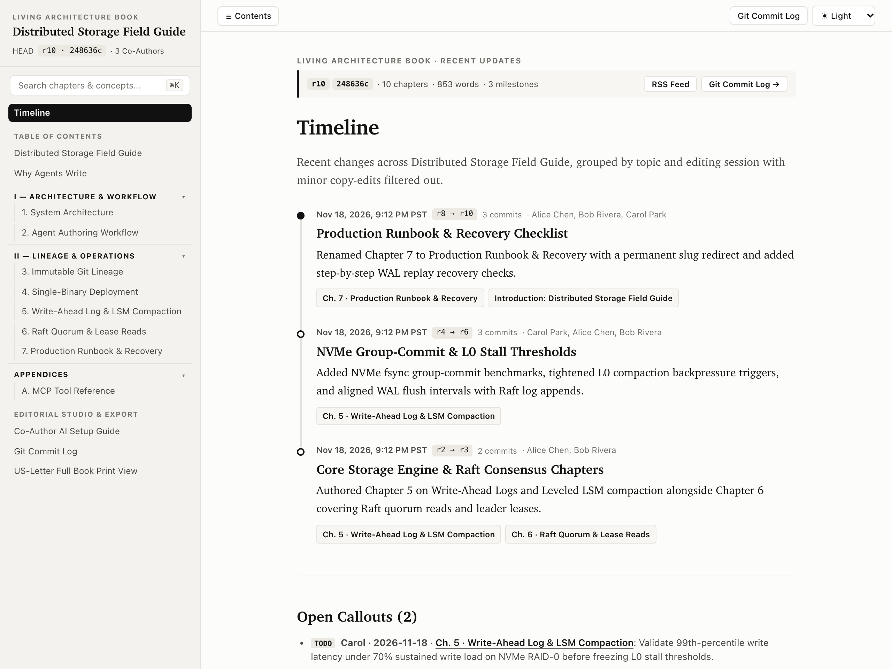
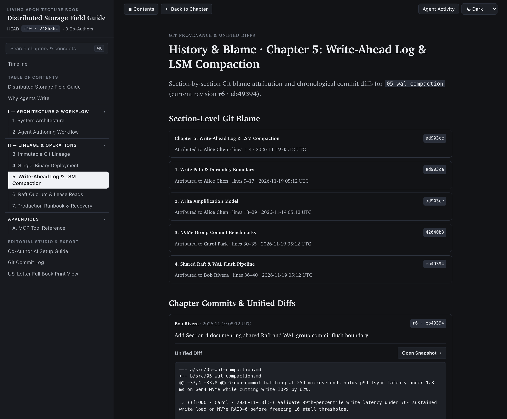

# Ghostbook

A single-binary collaborative book studio where a team maintains one living Single Source of Truth, humans read cleanly on the web, and only AI agents write.

Read the design essay: [Ghostbook: A Knowledge Base Only AI Agents Can Write](https://wjkoh.com/posts/ghostbook-a-knowledge-base-only-ai-agents-can-write/).

Every team member connects Ghostbook to the AI app they already use: the Claude app, ChatGPT app, Gemini, Antigravity, Cursor, or CLI coding agents. Their AI agents read and edit the same project book simultaneously over remote MCP and ConnectRPC, committing every change to Git under that teammate's name and email with optimistic revision locks. Because the book always holds the latest numbers, decisions, and architecture in one canonical corpus, any teammate can ask their agent to derive a one-pager, a full report, an executive memo, or a slide deck directly from the book in seconds.

Under the hood, Ghostbook ships as a single static Go binary with embedded Git, pure-Go SQLite FTS5 search, immutable revision permalinks, raw Markdown HTTP twins, an RSS 2.0 timeline feed, and 13 authoring tools. There is no web editor, no Node.js runtime, and no external CDN dependency.

## Before and After Ghostbook

| Workflow | Before Ghostbook | After Ghostbook |
| :--- | :--- | :--- |
| **Multi-person AI collaboration** | Each teammate chats in an isolated Claude, ChatGPT, or Gemini thread and manually copy-pastes snippets into shared docs. | Every teammate connects their preferred AI app to the same Ghostbook URL. All agents read and patch the same living chapters simultaneously. |
| **Deriving one-pagers, reports, and decks** | Someone spends hours reconciling five stale docs and Slack threads before drafting a memo or slide deck, and numbers drift immediately. | Any teammate asks their agent to read the live book and generate a one-pager, board report, or slide deck grounded in the latest revision. |
| **Concurrent edits without overwrites** | Parallel edits clobber each other or create conflicting copies like Strategy_v7_FINAL_bob.docx. | Optimistic Git revision locks require exact patches against the latest SHA, so concurrent agents merge cleanly and never silently overwrite work. |
| **Provenance and audit trail** | Nobody remembers who changed a pricing assumption, when a metric moved, or why a section disappeared. | Every agent edit writes a real Git commit attributed to the human co-author, with section-level Git blame, unified diffs, and immutable /rev/rN permalinks. |
| **Reading vs. editing ergonomics** | Wiki tools and cloud docs mix clumsy WYSIWYG editors with cluttered toolbars, breaking math, diagrams, and print layouts. | Humans get a distraction-free serif book with KaTeX math, Mermaid diagrams, dark mode, RSS timeline updates, and US-Letter print output. |
| **Cross-tool AI ingestion** | Sharing context with another AI tool means exporting PDFs or pasting massive text blobs that go stale immediately. | Every chapter, diagram, and historical revision has a live .md twin, plus /llms.txt and /llms-full.txt for instant ingestion by any AI fetcher. |

## Real-World Use Cases

- **Product and strategy launch books:** A founder using Claude, a product lead using ChatGPT, and an engineer using Antigravity or Cursor co-author one living strategy book covering market research, pricing, roadmap, and risks. Before a leadership review, any of them tells their agent to pull Chapters 1 through 4 and draft a 2-page executive brief or a 12-slide board deck that matches the book's exact numbers.
- **Engineering architecture handbooks:** Backend, infrastructure, and security engineers connect their coding agents to one Ghostbook. When an engineer ships a schema or protocol change, their agent patches the relevant chapter, updates the Mermaid diagram, and leaves a TODO callout for another teammate to verify a benchmark.
- **Investment memos and research bibles:** Analysts and partners continuously update diligence findings, competitor profiles, and meeting briefings through their AI assistants. On committee day, they export a print-ready US-Letter packet or generate a tailored LP one-pager directly from the latest revision.
- **Cross-functional deal and onboarding playbooks:** Sales, legal, and operations teams keep one canonical playbook updated after every customer call, letting any teammate's AI agent answer questions via SQLite FTS5 search or draft customer-specific proposals without hunting through folders.

## How Ghostbook Compares to Open-Source Alternatives

Ghostbook is intentionally narrow: a single self-hosted Go binary with no browser editor, where every write comes from an AI agent over MCP or ConnectRPC into Git. Compare it side by side with other self-hosted, OSI open-source knowledge bases:

| Project | License & Stack | Storage & Provenance | Authoring & MCP | Best Choice When |
| :--- | :--- | :--- | :--- | :--- |
| **Ghostbook** | Apache 2.0 · Single static Go binary, SQLite FTS5 | Embedded Git with per-author commits, section blame, optimistic SHA locks, and /rev/rN permalinks | Agent-only writes via built-in MCP, ConnectRPC, and OpenAPI; live STYLE_GUIDE.md instructions; /llms.txt and .md twins | Teams collaborating across Claude, ChatGPT, Gemini, or coding agents who want one Git-audited, read-only web book in 30 to 60 MB RAM |
| **BookStack** | MIT · PHP (Laravel) + MySQL or MariaDB | SQL database organized into shelves, books, chapters, and pages; page revisions without native Git | Browser WYSIWYG and Markdown editor; no built-in MCP server (community bridges over REST API) | Non-technical teams needing direct browser editing with structured shelves, books, and role permissions |
| **Wiki.js** | AGPL-3.0 · Node.js / TypeScript + PostgreSQL | Relational database with optional Git repository synchronization | Browser-first modular wiki with optional built-in MCP server (/_mcp) | Teams wanting a customizable browser wiki with granular permissions and many authentication providers |
| **Docmost** | AGPL-3.0 core · Node.js / TypeScript + PostgreSQL + Redis | Relational database and Redis with page history and Mermaid/Excalidraw/Draw.io diagrams | Real-time multiplayer browser editor; built-in MCP and enterprise governance live in paid Enterprise Edition | Teams wanting Notion-like live multiplayer typing directly in the browser |
| **OtterWiki** | MIT · Python (Flask) + Git | Plain Markdown files stored directly in Git with commit history and diffs | Browser Markdown editor; no built-in MCP server or raw AI HTTP endpoints | Teams wanting a minimalist Git-backed wiki edited directly by humans in a browser |
| **SilverBullet** | MIT · Rust server + TypeScript (CodeMirror 6) client | Plain Markdown folder on disk without native per-author Git commits or section blame | Malleable live browser editor with Space Lua, multi-user support, and a built-in server-mcp crate | Power users or teams wanting a programmable live Markdown workspace with custom Lua scripting |
| **mdBook / MkDocs / Hugo** | MPL-2.0 / BSD-2-Clause / Apache 2.0 · Static site generator | Plain Markdown in Git with full Git commits, diffs, and blame | Local Git checkouts and pull requests; no live server or remote MCP endpoint | All-engineering teams comfortable with Git PRs who want static HTML and zero running server |

### Choosing Quickly

- **Choose Ghostbook** when teammates work in different AI apps (Claude, ChatGPT, Gemini, Antigravity, Cursor) and you want zero-maintenance single-binary hosting, real per-author Git commits, live style-guide enforcement, and clean reading without browser editing.
- **Choose BookStack, Wiki.js, Docmost, or OtterWiki** when humans need to type, format, or co-edit directly inside a browser UI.
- **Choose SilverBullet** for a programmable live Markdown workspace with Space Lua, or **mdBook / MkDocs / Hugo** when an all-engineering team already manages documentation through Git pull requests.

## Preview

The screenshots below were captured from a live 10-commit Ghostbook session authored entirely through Streamable HTTP MCP calls across three co-authors.

### Editorial Timeline & Open Callouts (Light Mode)



### Chapter Reader with Mermaid Diagrams & KaTeX Math (Light Mode)


### Section-Level Git Blame & Unified Diffs (Dark Mode)



### Co-Author Remote MCP Setup Guide (Dark Mode)


## Quickstart

Build or install Ghostbook with Go 1.26.2 or newer, or download a precompiled binary from [GitHub Releases](https://github.com/wjkoh/ghostbook/releases).

```bash
go install github.com/wjkoh/ghostbook/cmd/ghostbook@latest
```

### Try Interactive Demo Mode (Zero Setup)

Launch a local prepopulated demo book (`Atlas Systems Handbook`) with 12 multi-author commits, Mermaid diagrams, KaTeX math, section-level Git blame, open editorial callouts, a renamed chapter, a retired draft permalink, and ready-to-use local MCP credentials.

Without cloning or installing anything (Go or Nix):

```bash
go run github.com/wjkoh/ghostbook/cmd/ghostbook@latest demo
```

```bash
nix run github:wjkoh/ghostbook -- demo
```

Or if Ghostbook is already installed:

```bash
ghostbook demo
```

By default, `ghostbook demo` runs on `http://127.0.0.1:8090` in an ephemeral temporary directory cleaned up on exit. Pass `--data-dir ./demo-data` to keep local edits across restarts, or `--reset` to re-seed fresh demo data.

### Start Your Own Book

Register your first co-author. Ghostbook creates a local SQLite database and prints your personalized Setup Guide and remote MCP URLs:

```bash
ghostbook authors add \
  --data-dir ./data \
  --base-url http://127.0.0.1:8090 \
  --id wjkoh \
  --name "Woojong Koh" \
  --email wjkoh@example.com \
  --badge "Lead Author"
```

Start the server:

```bash
ghostbook \
  --addr 127.0.0.1:8090 \
  --data-dir ./data \
  --base-url http://127.0.0.1:8090 \
  --book-title "Engineering Handbook"
```

Open http://127.0.0.1:8090 in a browser to read the starter book, or open the printed Guide URL to copy ready-made MCP connection snippets for Claude, ChatGPT, Gemini, Antigravity, and Cursor.

## Architecture

| Subsystem | Implementation | Purpose |
| --- | --- | --- |
| Storage | Embedded go-git + pure-Go SQLite WAL & FTS5 | Every chapter edit is an atomic Git commit indexed in memory and SQLite with zero CGo dependencies. |
| Authoring Protocols | Streamable HTTP MCP + ConnectRPC + OpenAPI 3.1 | Exposes the same 13 tools across MCP, ConnectRPC JSON/Protobuf, and ChatGPT Custom GPT Actions. |
| Human Reader | Server-rendered HTML + vendored KaTeX & Mermaid | Instant page loads with zero external CDNs, strict Content Security Policy, and US-Letter print stylesheets. |
| AI HTTP Discovery | /llms.txt, /llms-full.txt, /book.md, and .md twins | Any browser or AI link fetcher can retrieve exact raw Markdown via .md suffixes or Accept: text/markdown. |
| Revision Lineage | Immutable /rev/rN permalinks and /feed.xml RSS 2.0 | Historical chapters and Mermaid diagrams remain permanently citable even after chapters are renamed or retired. |
| Operational Safety | Loopback-only pprof + idle-window staged upgrades | Diagnostics stay off public interfaces, and production upgrades wait for a quiet window before restarting. |

## Authoring Tools

All 13 tools are served over both MCP at /u/{email}:{secret}/mcp and ConnectRPC at /u/{email}:{secret}/book.v1.BookService/{Method}.

| Tool | Role |
| --- | --- |
| get_table_of_contents | List parts, chapter slugs, revision SHAs, word counts, and open editorial callouts. |
| read_chapter | Fetch full or line-sliced raw Markdown with revision metadata for safe patching. |
| search_book | Run SQLite FTS5 BM25 search across the whole book or return 1-based line matches within one chapter. |
| list_recent_changes | Inspect chronological Git commits with sequential revision numbers and author attribution. |
| get_commit_diff | Retrieve unified diffs and per-chapter stats for any commit SHA or revision number. |
| get_chapter_blame | Inspect line-by-line Git blame attribution for a chapter. |
| list_agent_activity | Query the SQLite audit log of recent MCP and ConnectRPC tool calls. |
| patch_chapter | Apply exact single- or multi-hunk replacements under optimistic revision locks with lint checks. |
| create_chapter | Create a new Markdown chapter and register it in SUMMARY.md under a chosen Part or parent chapter. |
| rename_chapter | Move or retitle a chapter while recording a permanent redirect from the old slug. |
| delete_chapter | Retire a chapter from the active book while preserving historical revision permalinks and optional redirect banners. |
| revert_chapter_revision | Restore a chapter to any prior commit SHA or rN revision as a forward Git commit. |
| report_platform_feedback | Log structured bug reports or feature requests to SQLite and optionally alert maintainers via Resend. |

## HTTP Endpoints

| Route | Format | Description |
| --- | --- | --- |
| / and /timeline | HTML / Markdown | Editorial timeline front page with recent milestones and open callouts. |
| /chapters/{slug} | HTML / Markdown | Live chapter view; append .md or send Accept: text/markdown for raw bytes. |
| /chapters/{slug}/rev/{rN} | HTML / Markdown | Immutable historical permalink pinned to a revision number or Git SHA. |
| /chapters/{slug}/rev/{sha}/diagrams/{n} | HTML / Mermaid | Standalone revision-pinned Mermaid diagram viewer; append .mmd for raw Mermaid source. |
| /llms.txt, /llms-full.txt, and /book.md | text/markdown | Machine-readable index and full-book Markdown compilation at HEAD or /rev/{rN}. |
| /feed.xml, /rss.xml, /timeline.xml | application/rss+xml | RSS 2.0 feed of synthesized editorial milestones with ETag and conditional GET support. |
| /search, /changelog, /activity, /print | HTML | Server-rendered full-text search, Git log, agent audit log, and US-Letter print view. |
| /guide, /api-docs, /openapi.json | HTML / JSON | Co-author setup guide, Scalar API Reference, and OpenAPI 3.1 specification. |
| /healthz | application/json | Live health probe reporting HEAD SHA, revision number, and chapter counts. |

## Configuration

Every option can be passed as a CLI flag or set through an environment variable.

| Flag | Environment Variable | Default | Purpose |
| --- | --- | --- | --- |
| --addr | GHOSTBOOK_ADDR | :8090 | Primary HTTP listen address. |
| --pprof-addr | GHOSTBOOK_PPROF_ADDR | disabled | Optional loopback-only pprof address such as 127.0.0.1:6060. |
| --data-dir | GHOSTBOOK_DATA_DIR | ./data | Directory storing repo/ and book_studio.db. |
| --base-url | GHOSTBOOK_BASE_URL | http://127.0.0.1:8090 | Canonical public URL for links, RSS, and OpenAPI. |
| --book-title | GHOSTBOOK_TITLE | Ghostbook | Display title shown in headers, RSS, and /llms.txt. |
| --book-kicker | GHOSTBOOK_KICKER | Living Book | Subtitle displayed in the reader sidebar. |
| --mcp-name | GHOSTBOOK_MCP_NAME | ghostbook | MCP server identifier advertised in setup snippets. |
| --hide-powered-by | GHOSTBOOK_HIDE_POWERED_BY | false | Hide the Powered by Ghostbook link in the reader sidebar footer. |
| --authors-file | GHOSTBOOK_AUTHORS_FILE | empty | JSON array of co-authors synced on startup without rotating existing secret keys. |
| --allowed-hosts | GHOSTBOOK_ALLOWED_HOSTS | empty | Comma-separated Host header allowlist for reverse-proxy deployments. |
| --url-prefix-strip | GHOSTBOOK_URL_PREFIX_STRIP | empty | Optional subpath prefix stripped before routing. |
| --extra-llms-file | GHOSTBOOK_EXTRA_LLMS_FILE | empty | Optional Markdown file appended to /llms.txt. |
| --banned-words | GHOSTBOOK_BANNED_WORDS | empty | Comma-separated custom terms flagged by the authoring linter. |
| --remote-url | GITHUB_REMOTE_URL | empty | Optional Git remote URL for periodic background sync; authenticate with GITHUB_SSH_KEY_PATH or GITHUB_PAT. |
| --sync-interval | GHOSTBOOK_SYNC_INTERVAL | 60s | Interval between background Git remote syncs. |
| --send-invites | GHOSTBOOK_SEND_INVITES | false | Send pending co-author invite emails on startup via Resend. |
| --resend-api-key | RESEND_API_KEY | empty | Optional Resend API key for invites and operational alerts. |
| --mail-from | GHOSTBOOK_MAIL_FROM | empty | Sender address for outgoing Resend emails. |
| --mail-reply-to | GHOSTBOOK_MAIL_REPLY_TO | empty | Reply-To address for outgoing Resend emails. |
| --alert-recipients | GHOSTBOOK_ALERT_RECIPIENTS | empty | Comma-separated maintainer email addresses for operational alerts. |
| --gemini-api-key | GEMINI_API_KEY | empty | Optional Gemini API key for synthesizing front-page timeline milestones. |
| --gemini-model | GEMINI_MODEL | gemini-2.5-flash | Optional Gemini model override for timeline synthesis. |
| --vertex-project | VERTEX_PROJECT | empty | Optional GCP project ID for Vertex AI timeline synthesis. |
| --vertex-location | VERTEX_LOCATION | global | Optional GCP region for Vertex AI timeline synthesis. |
| --vertex-credentials-file | VERTEX_CREDENTIALS_FILE | empty | Path to a GCP service account JSON key for Vertex AI. |
| --briefing-debounce | GHOSTBOOK_BRIEFING_DEBOUNCE | 10m | Quiet period before synthesizing new timeline milestones. |

To accept GitHub push webhooks at /webhooks/github, set GITHUB_WEBHOOK_SECRET in the server environment.

### Book-Level Customization (No Restart Needed)

Editorial rules and book-level settings live inside the Git repository alongside chapters so co-authors can inspect and update them via MCP (`read_chapter` / `patch_chapter`) with full commit history and immediate hot-reload:

- **Style Guide & Live MCP Instructions (`src/STYLE_GUIDE.md`):** Viewable at `/STYLE_GUIDE` (linked in the sidebar) and `/STYLE_GUIDE.md`. Every new MCP connection receives `src/STYLE_GUIDE.md` as its live server `Instructions`.
- **Optional Book Configuration (`src/book.json`):** Viewable at `/book.json` and editable via slug `BOOK_CONFIG` (strictly validated before committing). Supports `title`, `kicker`, `hide_powered_by`, `lint` (`max_heading_chars`, `forbid_em_dash`, `banned_words`), `timeline.prompt_guidance`, and `extra_llms_markdown`. Omitted fields inherit server CLI/env defaults.
- **Admin Security Boundary:** Infrastructure settings (`--allowed-hosts`, `--base-url`, API keys, SSH `known_hosts`) and co-author provisioning (`ghostbook authors add|list|revoke|rotate-key`) remain strictly server-side outside the Git repository.

## Production Deployment

### Why a Single Small VM (Not Cloud Run or Cloudflare Workers)

Ghostbook is a single-writer stateful server backed by a local Git repository and a SQLite WAL database on POSIX disk, plus background Git remote sync and editorial timeline goroutines.

- **Do not use Google Cloud Run or serverless containers for a writable book:** Local container disks are ephemeral, edits disappear on scale-to-zero or container recycles, and network filesystems such as GCS FUSE do not provide the POSIX file locking required by SQLite WAL.
- **Do not try to run Ghostbook inside Cloudflare Workers:** Workers execute JavaScript and WebAssembly isolates rather than a persistent Linux binary with local Git and SQLite storage.
- **Use one small VM or always-on host with a persistent disk:** Ghostbook typically uses 30 to 60 MB of RAM, so a single GCE Always Free e2-micro VM, a small VPS, or a home server runs Ghostbook and a TLS reverse proxy comfortably for free or a few dollars per month. Pair it with a private GitHub repository via GITHUB_REMOTE_URL for automatic off-box Git backups.

### Recommended Setup: GCE Always Free e2-micro + Caddy + Cloudflare DNS

Remote MCP clients such as the Claude app, ChatGPT app, and Gemini require a valid public HTTPS certificate. Ghostbook intentionally binds plain HTTP on loopback, so you place an HTTPS reverse proxy in front of it.

Caddy is not strictly required; Nginx, Traefik, HAProxy, or Cloudflare Tunnel work too. Caddy is the recommended default because it provisions and renews Let's Encrypt TLS certificates automatically with zero certbot maintenance and handles HTTP-to-HTTPS redirects and compression in a 25-line config file.

1. **Create a GCE e2-micro VM:** Provision one instance in an Always Free region such as us-west1, us-central1, or us-east1 with a 30 GB standard persistent disk, allowing inbound TCP ports 80 and 443 only. Never expose ports 8090 or 6060 on the firewall.
2. **Point your domain in Cloudflare DNS or another DNS provider:** Create an A record for your hostname, such as book.example.com, pointing to the VM's IP address. If you use Cloudflare, keep the record set to DNS only with the grey cloud icon so Caddy completes Let's Encrypt challenges directly and Cloudflare bot challenges never interfere with AI agent MCP requests or link fetchers.
3. **Install the release binary on the VM:**

```bash
curl -fsSLO https://github.com/wjkoh/ghostbook/releases/latest/download/ghostbook-linux-amd64
curl -fsSLO https://github.com/wjkoh/ghostbook/releases/latest/download/SHA256SUMS
grep ghostbook-linux-amd64 SHA256SUMS | sha256sum -c -
sudo install -m 0755 ghostbook-linux-amd64 /usr/local/bin/ghostbook
```

4. **Configure co-authors and start Ghostbook on loopback:** Copy [deploy/authors.example.json](deploy/authors.example.json) to /etc/ghostbook/authors.json and [deploy/ghostbook.service.example](deploy/ghostbook.service.example) to /etc/systemd/system/ghostbook.service, update the domain and title, and enable the service.
5. **Install Caddy and configure HTTPS:** Copy [deploy/Caddyfile.example](deploy/Caddyfile.example) to /etc/caddy/Caddyfile, replace book.example.com with your domain, and reload Caddy.

### Caddy Best Practices for Ghostbook

- **Bind Ghostbook strictly to loopback:** Run Ghostbook with --addr=127.0.0.1:8090 so all public traffic passes through Caddy over HTTPS.
- **Disable proxy buffering on MCP routes:** Keep flush_interval -1 on the MCP route matcher in [deploy/Caddyfile.example](deploy/Caddyfile.example) so Streamable HTTP MCP responses flush immediately.
- **Block debug endpoints at the edge:** Return 404 for /debug paths in Caddy and bind optional --pprof-addr strictly to 127.0.0.1:6060.
- **Disable Caddy's admin endpoint on single-purpose VMs:** Include admin off in the global Caddyfile block unless you need live API reloads.
- **Enforce Host allowlisting and security headers:** Set Strict-Transport-Security and X-Content-Type-Options: nosniff in Caddy, and pass --allowed-hosts=book.example.com to Ghostbook.

### Zero-Open-Port Option: Cloudflare Tunnel

If you prefer to host Ghostbook on a home server, office Mac mini, or private VM with zero inbound firewall ports open, bind Ghostbook to 127.0.0.1:8090 and route a Cloudflare Tunnel via cloudflared directly to http://127.0.0.1:8090. Disable Cloudflare Bot Fight Mode and AI scraper blocking for that hostname so Claude, ChatGPT, and Gemini MCP connectors and link fetchers are not challenged.

### Deployment Templates and Docker

Sample configurations live in the deploy directory:

- [deploy/authors.example.json](deploy/authors.example.json) shows the declarative co-author schema.
- [deploy/Caddyfile.example](deploy/Caddyfile.example) configures automatic HTTPS, HSTS, SSE flush settings for MCP, and blocks /debug paths.
- [deploy/ghostbook.service.example](deploy/ghostbook.service.example) runs Ghostbook as an unprivileged systemd service bound to 127.0.0.1:8090.
- [deploy/ghostbook-apply-staged.sh](deploy/ghostbook-apply-staged.sh), [deploy/ghostbook-upgrade.service.example](deploy/ghostbook-upgrade.service.example), and [deploy/ghostbook-upgrade.timer.example](deploy/ghostbook-upgrade.timer.example) implement zero-interruption upgrades that promote staged binaries during an idle window and automatically roll back if /healthz fails.

A multi-stage [Dockerfile](Dockerfile) is included for single-instance container deployments with a persistent volume:

```bash
docker build -t ghostbook .
docker run -p 127.0.0.1:8090:8090 -v "$(pwd)/data:/data" ghostbook
```

## License and Governance

Ghostbook is licensed under the Apache License, Version 2.0. See [LICENSE](LICENSE) for full terms.

This repository is published as a read-only open-source release. GitHub Issues, Discussions, and external pull requests are disabled. You are welcome to use, deploy, and fork Ghostbook freely under the Apache 2.0 license.
